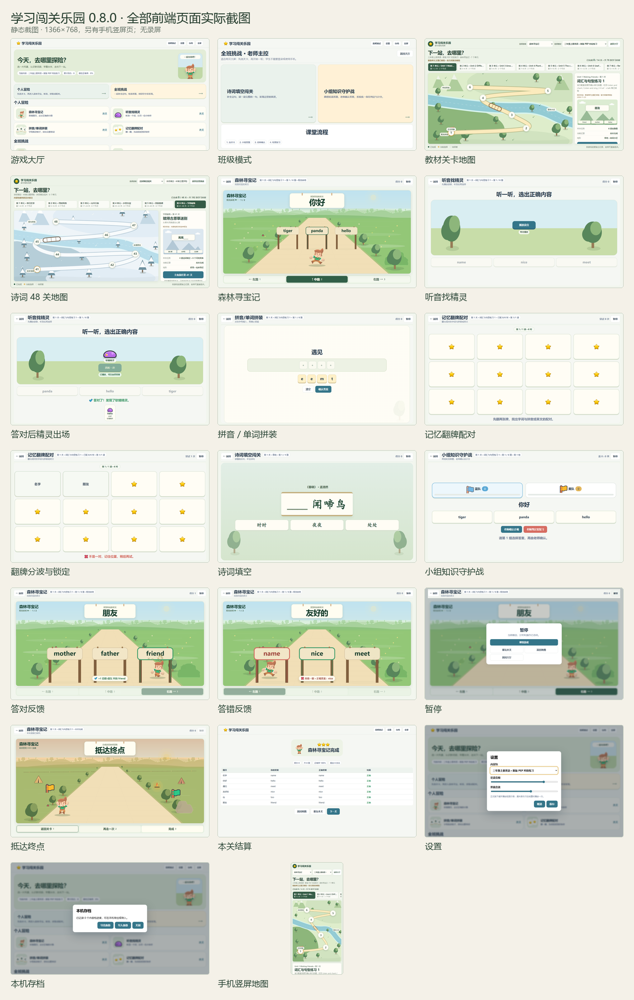
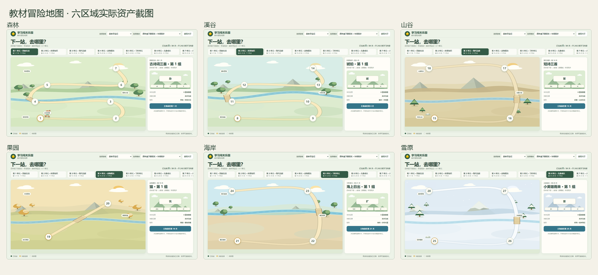
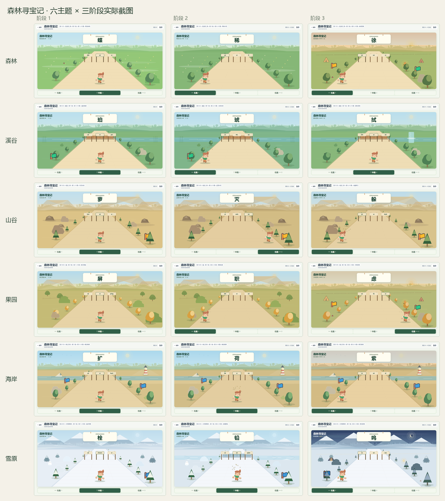
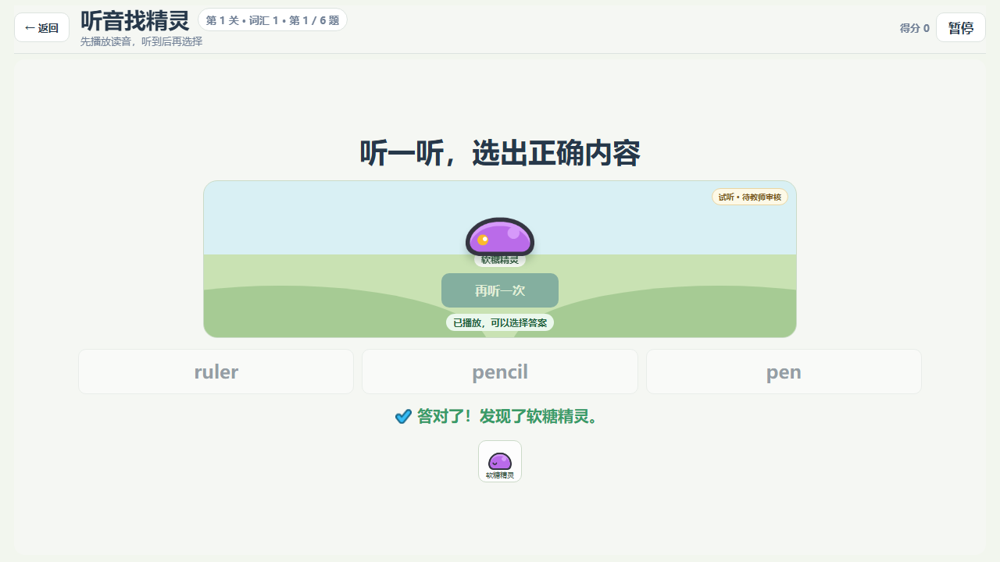
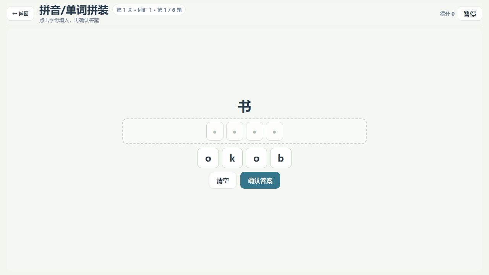
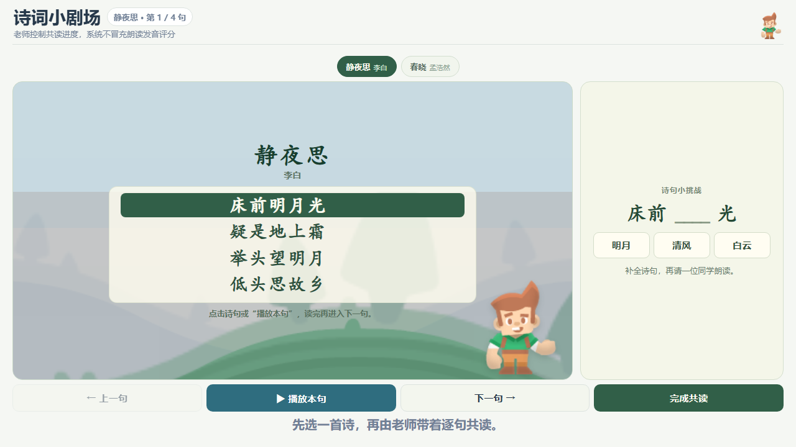
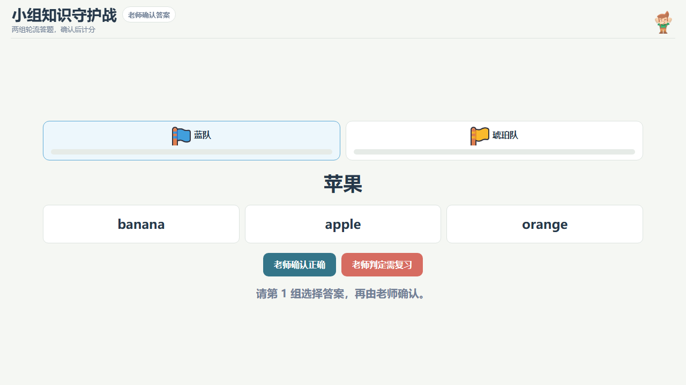

# classGame · 学习闯关乐园

面向小学课堂的离线学习游戏。当前版本为 `0.8.0`。仓库只保留源码、素材、截图说明和 Release 交付物。

## 下载

- 绿色版：`classGame-0.8.0-x64-green.zip`
- GitHub Release：<https://github.com/w1-23/classGame/releases/tag/v0.8.0>

绿色版解压后运行 `学习闯关乐园.exe`。当前 Release 只保留绿色版，不再提供安装包或其他版本。

## 页面总览



## 游戏类型与内容

| 游戏 | 玩法 | 学习内容 |
|---|---|---|
| 森林寻宝记 | 看题选择左、中、右道路，主角沿路前进 | 语文生字词、英语词表、拼音与诗词关卡 |
| 听音找精灵 | 播放本地范读，选对后精灵出场并加入伙伴栏 | 英语单词、中文词语、拼音听辨 |
| 拼音/单词拼装 | 把字母或拼音块拖入格子，拼成完整答案 | 英语单词拼写、拼音组合 |
| 记忆翻牌配对 | 分波翻牌，把中文与英文、字词与拼音配对 | 词汇、字词、同音辨析 |
| 诗词填空闯关 | 在画卷中补全诗句，答后展示完整原句 | 48 首古诗、48 关、384 个填空变体 |
| 小组知识守护战 | 两队轮流答题，教师确认后推进比分 | 课堂分组复习与即时反馈 |





## 内容范围

- 语文：一年级上册至六年级下册，生字与词语练习。
- 英语：一年级上册至六年级下册，词表与拼写练习。
- 拼音：一年级上册拼音练习。
- 古诗：6 个主题、48 首、48 关。
- 题库结构由 `data/manifest.json` 和各内容包配置，可继续扩充。

内容按教材单元组织为连续编号关卡；不同游戏分别保存进度。老师可直接选择关卡，不会补记中间关卡成绩。

## 截图











## 开发

```powershell
conda activate GAME
npm install
npm start
```

验证命令：

```powershell
npm test
python tools/validate_content.py
```
