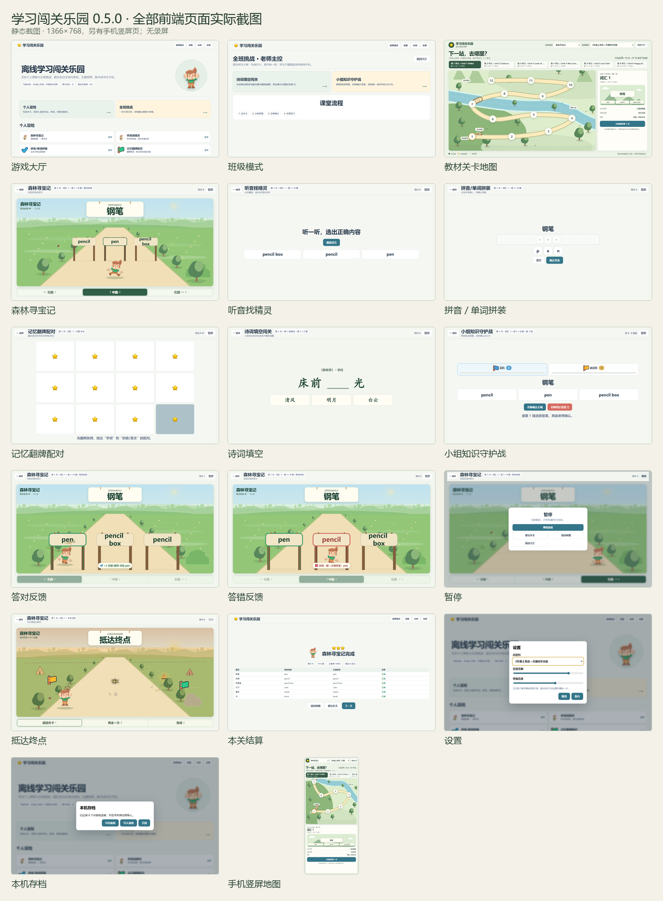
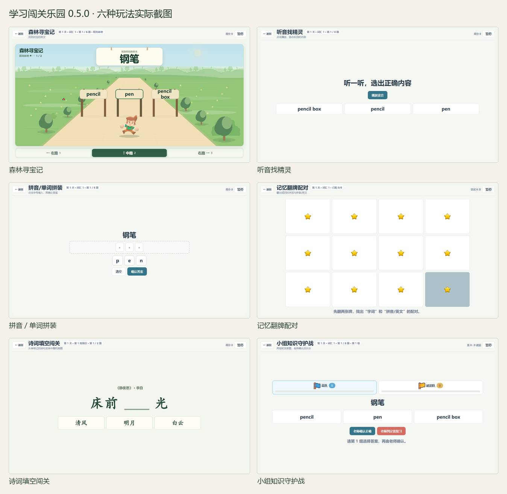
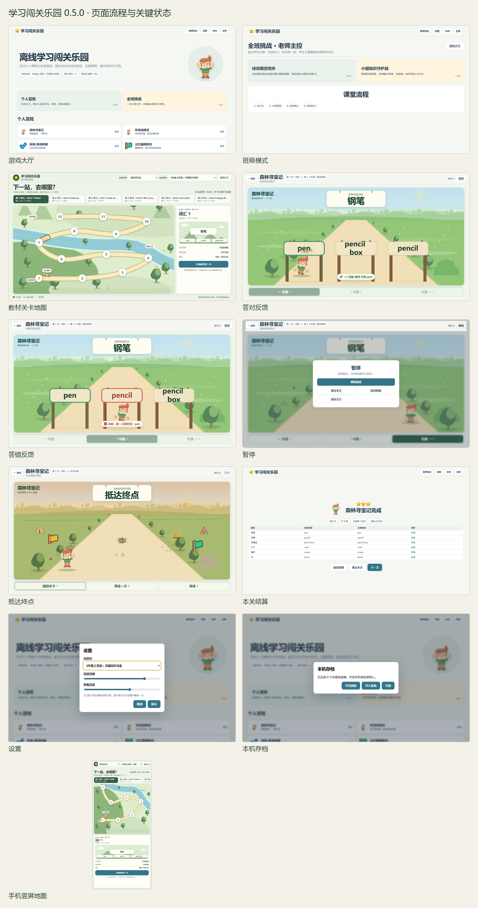
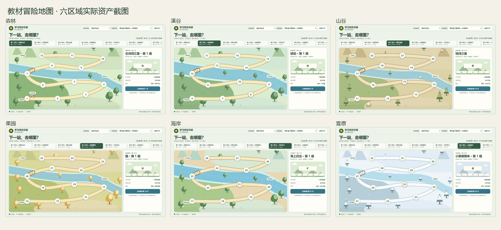
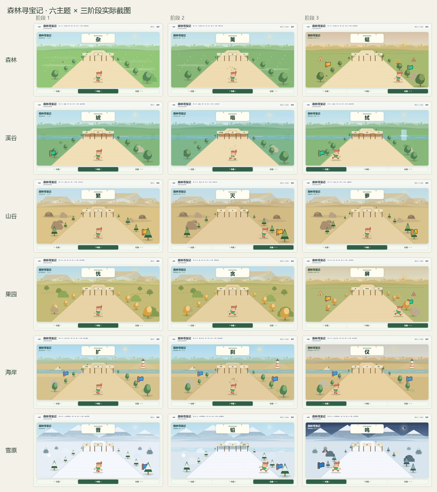

# classGame 0.5.0 前端页面与构建验收报告

日期：2026-11-22

## 结论

本轮已完成教材冒险地图、六种玩法页面、设置与存档弹窗、森林寻宝记六区域十八阶段场景，以及诗词填空页字段缺失问题的修复。前端自动化回归为 `37/37` 通过。

本轮按用户要求没有执行安装、卸载、断网安装或希沃真机验证，也没有生成录屏。安装包已重新构建，但安装可用性不在本轮结论内。

## 构建产物

| 项目 | 实际结果 |
|---|---|
| 文件 | `release/classGame-0.5.0-x64-setup.exe` |
| 大小 | 116,945,775 字节（111.53 MiB） |
| 构建时间 | 2026-11-22 20:34:18 |
| SHA-256 | `8985A4DD7E5F8D1C56A1AA050D4F0B1ECFDC1953D7C48AAC879C2B40ACC397FB` |
| 数字签名 | `NotSigned` |
| 便携版 | 本轮未生成 |

已检查打包后的 `release/win-unpacked/resources/app.asar`，其中包含本轮诗词标题、作者和完整诗句字段修复。未启动安装程序进行安装验证。

## 游戏与内容

### 六种玩法

| 模式 | 游戏 | 选择入口 | 当前作用 |
|---|---|---|---|
| 个人冒险 | 森林寻宝记 | 游戏大厅 → 个人冒险 | 三通道选路、碰撞、连击、暂停和结算 |
| 个人冒险 | 听音找精灵 | 游戏大厅 → 个人冒险 | 播放离线读音并选择对应内容 |
| 个人冒险 | 拼音 / 单词拼装 | 游戏大厅 → 个人冒险 | 按字母或拼音片段拼装答案 |
| 个人冒险 | 记忆翻牌配对 | 游戏大厅 → 个人冒险 | 字词与拼音/英文配对，错误翻回有锁定 |
| 全班挑战 | 诗词填空闯关 | 游戏大厅 → 全班挑战 | 从审核过的古诗挖空题中选答案 |
| 全班挑战 | 小组知识守护战 | 游戏大厅 → 全班挑战 | 两队轮流答题，由老师确认正确或需复习 |

### 科目与内容覆盖

| 内容 | 实际数量 |
|---|---:|
| 内容包 | 26 |
| 英语册数 | 12 |
| 英语学习条目 | 1288 |
| 语文册数 | 12 |
| 语文学习条目 | 3141 |
| 一年级拼音条目 | 47 |
| 学习条目合计 | 4476 |
| 古诗 | 2 首 |

内容校验脚本结果：`CONTENT VALIDATION PASSED`。

### 古诗覆盖确认

当前版本**没有覆盖全部小学古诗**，只有：

1. 《静夜思》· 李白
2. 《春晓》· 孟浩然

因此不能把当前版本描述为“古诗全册覆盖”。本轮修复了诗词页显示 `《undefined》 · undefined` 的字段错误，但没有虚构补齐缺失诗篇。若要覆盖 1–6 年级全部教材诗篇，需要先确定教材版本、年级册次和诗篇清单，再逐首录入正文、作者、挖空题、干扰项和审核记录。

### 选择流程

1. 在大厅选择“个人冒险”或“全班挑战”。
2. 选择六种玩法中的一种。
3. 在地图顶部选择年级和教材册次。
4. 在单元标签中选择单元。
5. 点击地图上的连续编号关卡，查看本关内容、题量和场景。
6. 点击“主角前往第 N 关”进入游戏。
7. 通关后保存成绩，主角移动到下一推荐关卡；直接跳关不会补记中间关卡成绩。

## 地图与场景

- 地图使用资产包中的分层绘制方式重建，包含远景、河道、木桥、山路、树簇、岩石和地形主题。
- 六个区域为森林、溪谷、山谷、果园、海岸、雪原。
- 森林寻宝记在区域内继续分为三个阶段，共六主题十八阶段。
- 场景会改变天空、远山、地面材质、植被、桥梁、营地、果园、海岸、月光与星空。
- 角色继续使用工程内 Kenney Toon Characters 素材，地图与局内植被使用资产包中的正式绘制基件和确定性光栅化纹理。

## 自动化验证

已执行：

```powershell
conda run --no-capture-output -n GAME npx playwright test --reporter=line
conda run --no-capture-output -n GAME python tools/validate_content.py
conda run --no-capture-output -n GAME npm run dist
```

结果：

- Playwright：`37 passed (2.4m)`。
- 静态内容校验：26 个内容包、12 册英语、12 册语文、4476 条学习内容通过。
- Windows NSIS 安装包构建完成。
- 未执行安装、卸载、断网安装和希沃真机测试。

测试覆盖包括：

- 三车道切换、答案门碰撞、正确/错误判定、连击和自动下一题。
- 暂停和恢复、连续关卡、结算页和关卡成绩保存。
- 六种玩法共用游戏框架，以及个人/班级不同选择流程。
- 设置与存档弹窗可正常打开和关闭。
- 听音与拼装判定、记忆翻牌锁定、诗词填空和班级计分。
- 六区域地图与六主题十八阶段跑酷场景。
- 六档视口无页面整体滚动。
- 离线运行时只请求本地资源。

## 前端页面截图

全部页面总览：



六种玩法可读版：



页面流程与关键状态：



六区域地图：



跑酷六主题三阶段：



单独页面文件位于 `docs/screenshots/`，包括大厅、班级模式、地图、六种玩法、答对、答错、暂停、终点、结算、设置、本机存档和手机竖屏地图。本轮没有生成录屏。

## 尚未解决

- 古诗只有 2 首，未覆盖 1–6 年级全部教材诗篇。
- 语文同步字词和英语开源词表仍需按学校实际使用的教材版本逐册核对。
- 安装包未签名，Windows 会显示“未知发布者”安全警告。
- 按本轮要求未验证安装、卸载、断网安装和希沃触控/全屏/声音。
- 听音找精灵、拼装、翻牌和诗词页的视觉丰富度仍低于森林寻宝记，后续不宜用“功能已通过”替代视觉评审。
