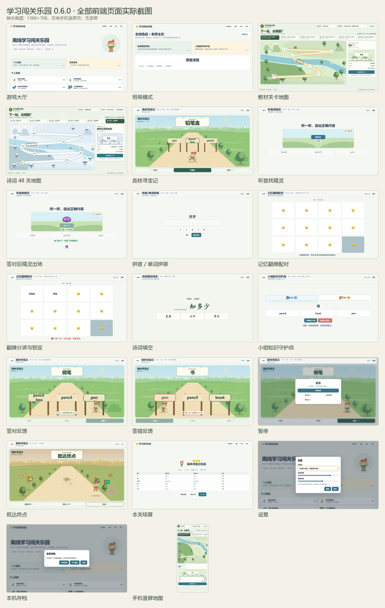
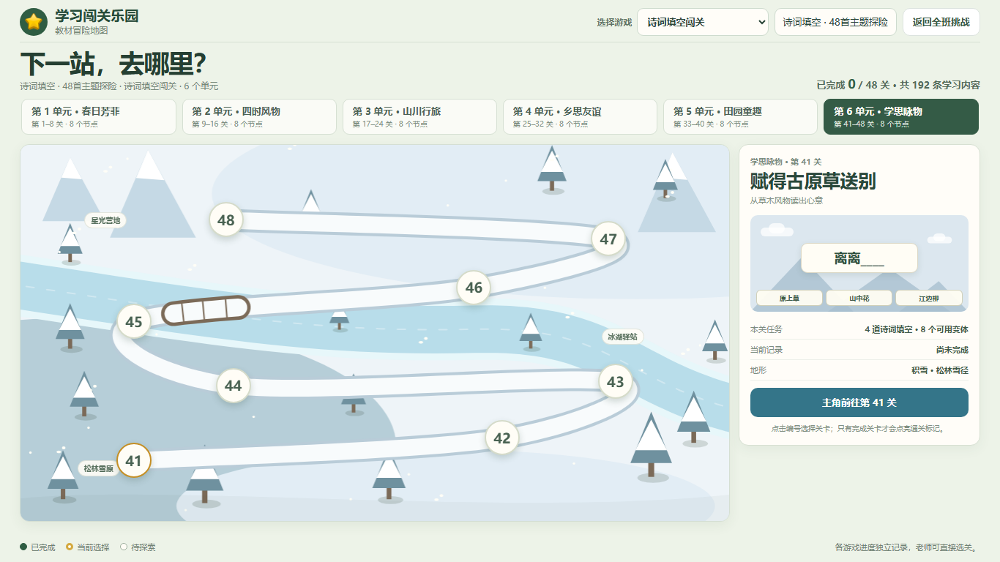
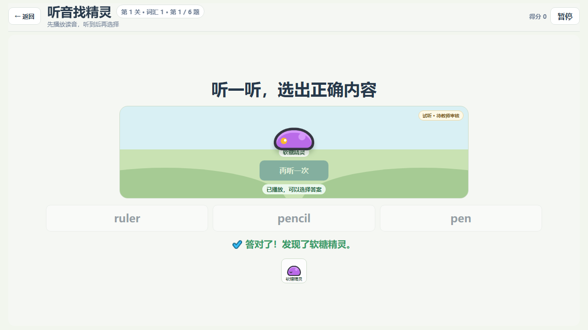
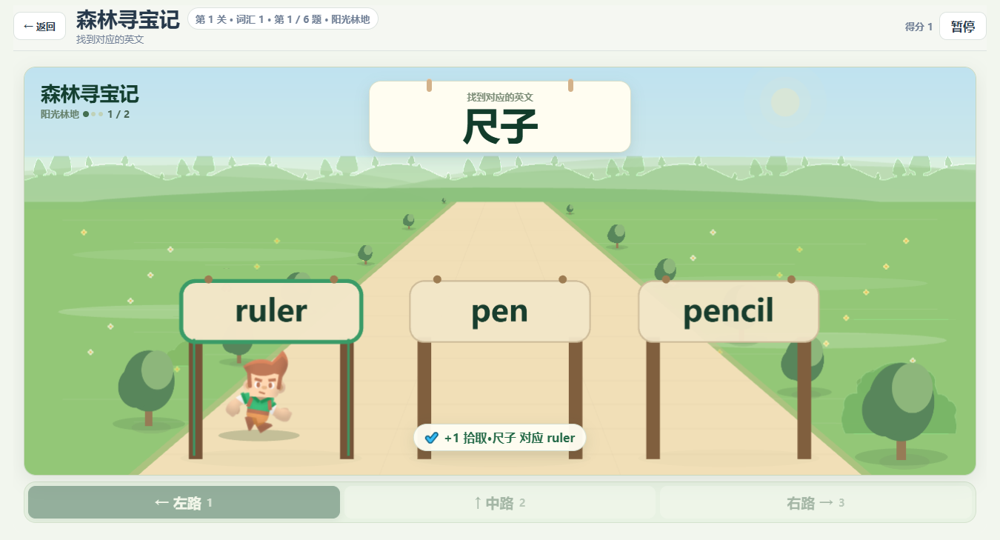

# classGame 0.6.0 前端页面与构建验收报告

日期：2026-11-23

## 结论

本轮完成 0.6.0 的内容与运行时整改：本地读音、随机新局、听音精灵出场、黄队命名、48 首诗词扩展和配套截图均已接入。全量自动化测试为 `41/41` 通过，内容校验通过，Windows NSIS 安装包已重新构建。

按本轮要求，未执行安装、卸载、断网安装或希沃真机验证，也没有生成录屏。安装包未签名，Windows 会显示未知发布者提示；这不等同于安装或卸载已经验收通过。

## 构建产物

| 项目 | 实际结果 |
|---|---|
| 文件 | `release/classGame-0.6.0-x64-setup.exe` |
| 大小 | 167,323,406 字节（159.57 MiB） |
| 构建时间 | 2026-11-23 01:07:33 |
| SHA-256 | `BBFF16984DF510C91C9305CD07197BDCC44D14EF7A0E556A8E1545BDD5D280D6` |
| 数字签名 | `NotSigned` |
| 便携版 | 本轮未生成 |

已检查 `release/win-unpacked/resources/app.asar`：共 6,396 个条目，包含 `assets/spirits/`、`data/poetry-cloze-48-v1.json` 和 3,469 个 `audio/generated/*.wav`。解包版主程序 `学习闯关乐园-core.exe` 已实际启动并完成一局 6/6 题，运行期间外部请求为 0。该项验证不包含安装程序、安装后目录或卸载流程。

## 运行方式

开发预览：

```powershell
cd "E:\codex_WORKSPACES\临时任务目录\classGame"
conda run --no-capture-output -n GAME npm start
```

直接使用本次构建：

```text
E:\codex_WORKSPACES\临时任务目录\classGame\release\classGame-0.6.0-x64-setup.exe
```

安装包需要用户自行运行；由于未签名，系统可能显示“未知发布者”。本轮没有对该安装过程做验收。

## 本轮整改

### 读音与听音

- 导入 3,469 个本地 WAV，覆盖内容引用；听音题不再只依赖系统文字转语音。
- 本地音频优先，系统朗读作为后备；增加播放中、播放完成、播放失败和取消状态。
- 读音未成功播放时答案保持锁定，失败不计错，可重听后再答。
- 生成音频全部标记为 TTS 预览、待教师审核；47 条拼音预览仍需人工听审。
- WAV 结构、时长和非静音检查为 `3469/3469` 通过；这不等于发音已经教师审核通过。

### 随机性

- 新一局重新生成题序、正确选项位置和翻牌分波。
- 正确选项位置在整局中均衡分配，并限制连续同位置。
- 暂停与恢复复用当前局计划，不会重新打乱正在作答的牌面或答案。
- 翻牌按波次处理，同音卡拆到不同波，避免隐藏 ID 造成误判。
- 诗词从已校验的 384 个填空变体中按组抽样，而不是固定只出现同一道题。

### 精灵与队伍

- 接入 Kenney New Platformer Pack 的 9 个精灵角色、27 张透明 PNG。
- 听音答对后精灵在游戏场景内出场，动画结束后保留在本局伙伴栏。
- “琥珀队”统一改为“黄队”，保留黄色旗帜。
- 小组战按双方等量轮次出题，避免奇数题时先手多答一题。

### 诗词内容

- 诗词包替换为 6 个主题、48 个关卡、每关 8 个填空变体，共 384 个变体。
- 六主题为春日芳菲、四时风物、山川行旅、乡思友谊、田园童趣、学思咏物。
- 每首诗保留原文、作者、采用版本和来源说明。
- 这 48 首是主题扩展包，**不能据此声称已经覆盖某个出版社、某个年级册次的全部教材古诗**；正式课堂使用前仍需按实际教材目录终审。

### 存档与入口

- 无关 JSON 导入会被拒绝，并保留原存档。
- 已经通关的关卡不会因为后来重玩失败而撤销通关标记。
- 教材地图保留真实单元、课文、关卡和题量信息；直接跳关不会补记中间关卡成绩。
- 主角沿地图实际路线移动，地图、关卡预览和局内区域使用一致的场景主题。

## 内容与玩法

### 六种玩法

| 模式 | 游戏 | 主要操作 |
|---|---|---|
| 个人冒险 | 森林寻宝记 | 三通道选路、碰撞、连击、暂停和结算 |
| 个人冒险 | 听音找精灵 | 本地读音播放、选答案、答对后精灵出场 |
| 个人冒险 | 拼音 / 单词拼装 | 按字母或拼音片段拼装答案 |
| 个人冒险 | 记忆翻牌配对 | 分波翻牌，字词与拼音/英文配对 |
| 全班挑战 | 诗词填空闯关 | 48 关诗词填空，随机挖空变体 |
| 全班挑战 | 小组知识守护战 | 黄队/蓝队等量轮次答题 |

### 内容统计

| 内容 | 数量 |
|---|---:|
| 内容包 | 26 |
| 英语册数 | 12 |
| 英语学习条目 | 1,288 |
| 一年级拼音条目 | 47 |
| 语文册数 | 12 |
| 语文学习条目 | 3,141 |
| 学习条目合计 | 4,476 |
| 诗词关卡 | 48 |
| 诗词填空变体 | 384 |
| 生成 WAV | 3,469 |

## 自动化验证

已执行：

```powershell
conda run --no-capture-output -n GAME npm test
conda run --no-capture-output -n GAME python tools\validate_content.py
conda run --no-capture-output -n GAME npm run dist
node tools\verify_packaged.mjs release\win-unpacked\学习闯关乐园-core.exe docs\screenshots\packaged-0.6.0.png
```

结果：

- 全量测试：`41 passed (2.5m)`。
- 内容校验：`CONTENT VALIDATION PASSED`；26 个内容包、12 册英语、12 册语文、4,476 条学习内容、48 个诗词关卡、384 个变体。
- 解包版程序：完成 6/6 题，`Remote requests: 0`。
- 安装、卸载、断网安装和希沃真机验证：本轮未执行。

测试覆盖新增了读音失败锁定、精灵出场、翻牌分波、48 关诗词、随机新局、暂停保留计划、存档导入拒绝和通关状态保留等场景。

## 前端页面截图

全部页面静态总览：



48 首诗词地图与随机题池：



听音答对后的精灵出场：



解包版程序实际运行截图：



单页文件位于 `docs/screenshots/`，包括大厅、班级模式、教材地图、六种玩法、答对/答错反馈、暂停、终点、结算、设置、本机存档、手机竖屏地图和六区域场景。没有录屏文件。

## 尚需人工确认

- TTS 预览尚未逐条教师审核，尤其是 47 条拼音。
- 48 首诗词按主题编排，未完成某个具体教材版本的逐册覆盖核对。
- 语文与英语内容仍需按学校实际使用的教材版本逐册核对。
- 安装包未签名；Windows 安全提示属于预期现象。
- 按本轮要求没有验证安装、卸载、断网安装和希沃触控/全屏/声音。
