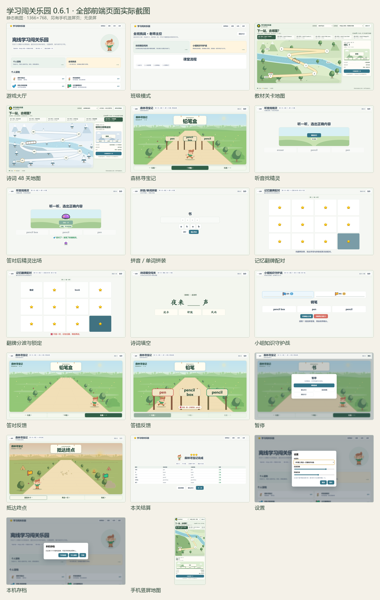
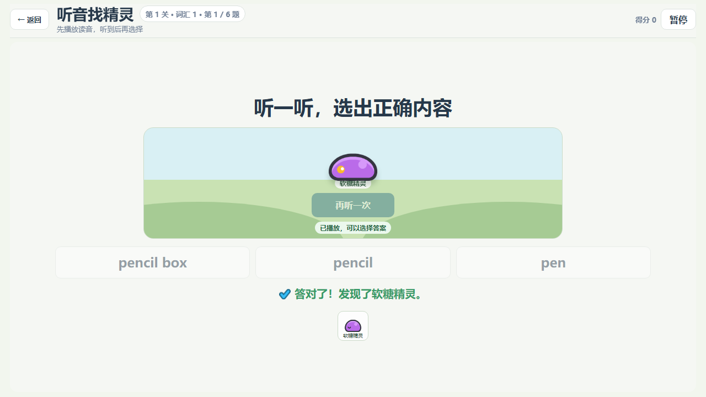
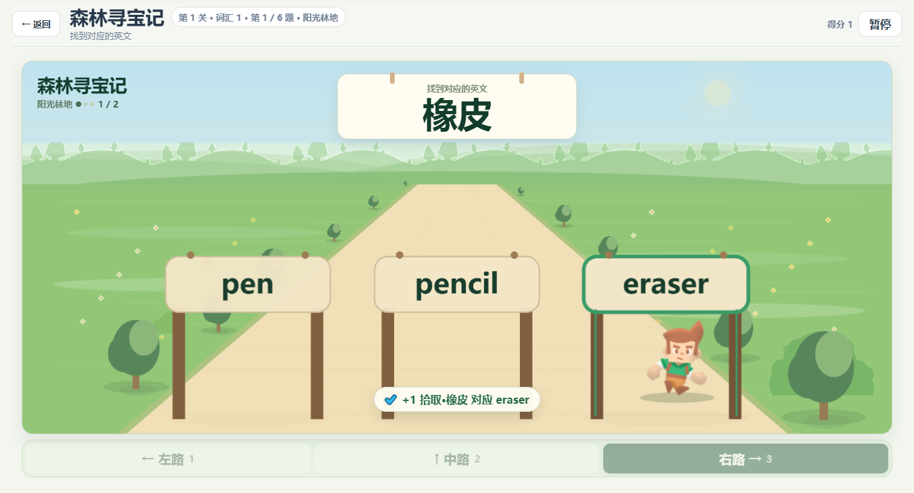

# classGame 0.6.1 前端页面与构建验收报告

日期：2026-11-23

## 结论

本轮只处理用户确认后的音频展示问题：移除听音页“试听 · 待教师审核”角标和相关界面提示，保留 0.6.0 的全部功能、内容、随机计划、精灵出场和 48 首诗词扩展。版本升级为 `0.6.1`。

用户已确认音频正常。本轮不执行安装、卸载、断网安装或希沃真机验证，也没有生成录屏。

## 构建产物

| 项目 | 实际结果 |
|---|---|
| 文件 | `release/classGame-0.6.1-x64-setup.exe` |
| 大小 | 167,323,320 字节（159.57 MiB） |
| 构建时间 | 2026-11-23 09:35:03 |
| SHA-256 | `9B55D14F48C5CF86E1B194E5B0D3F7921A5F217D3CEE7581E7381EE981FEFEED` |
| 数字签名 | `NotSigned` |
| 便携版 | 本轮未生成 |

已检查解包版主程序，实际完成 6/6 题，运行期间外部请求为 0。该检查不包含安装、卸载和希沃真机流程。

## 本轮变更

- `js/games.js`：不再根据 `audioReview` 渲染“试听 · 待教师审核”角标。
- `css/style.css`：删除 `.audio-review-tag` 样式。
- `tests/e2e/games.spec.js`：新增断言，听音页不得出现 `.audio-review-tag`。
- `README.md`：更新为 0.6.1，并改为“用户已确认音频正常”。
- 版本号同步到 `package.json`、`package-lock.json`、截图生成和验证脚本。

## 验证

- 听音页截图重新生成，确认不再显示审核角标。
- 全量自动化测试 `41/41` 通过；内容校验通过。
- 解包版主程序实际完成 6/6 题，外部请求为 0。
- 前端总览图更新为 `docs/screenshots/0.6.1-pages-overview.png`。

## 静态截图

