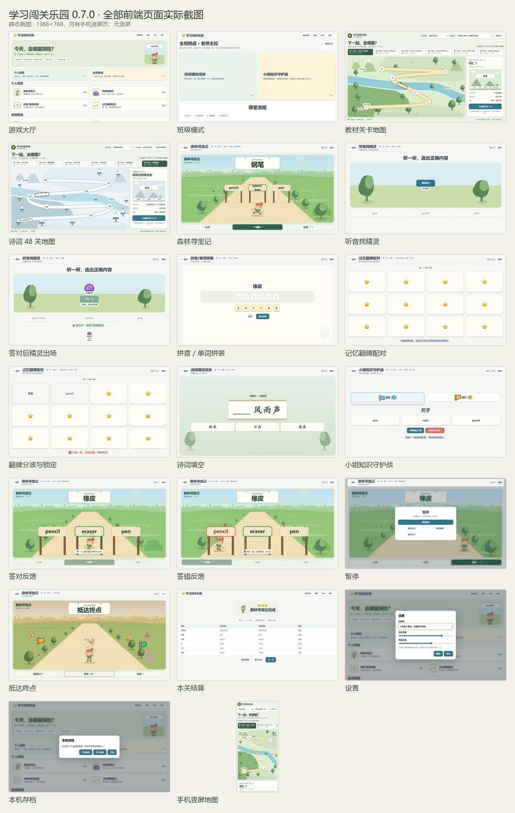
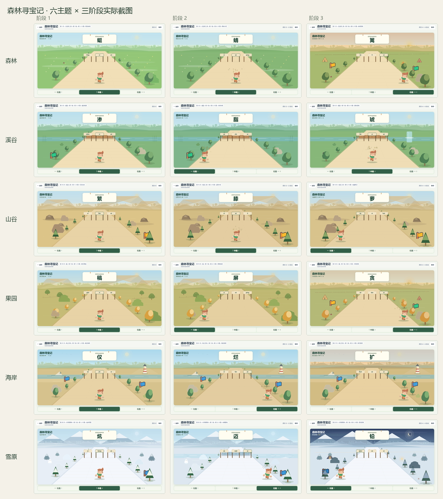
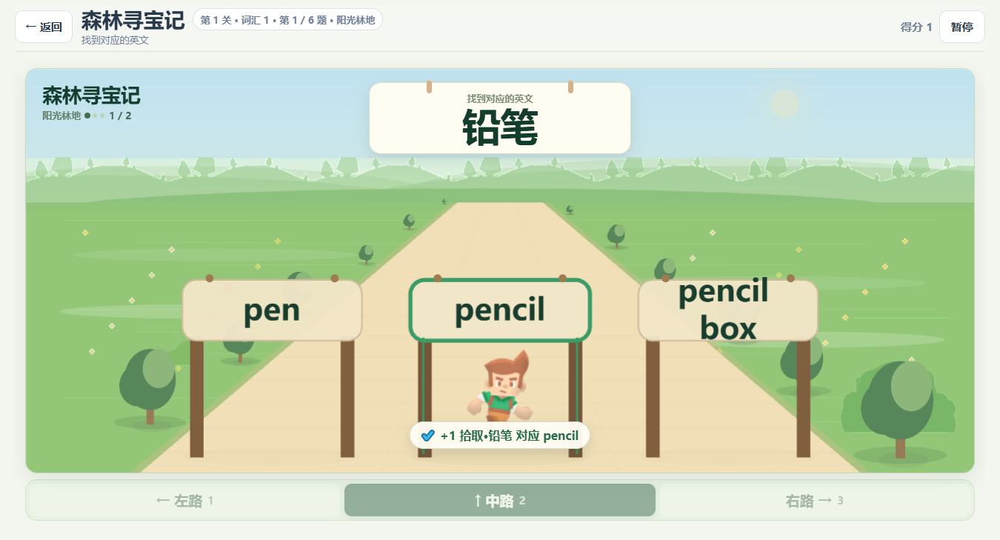

# classGame 0.7.0 前端页面与构建验收报告

日期：2026-11-23

## 结论

本轮把 `v0.6.1 UI interaction kit` 的整合补丁接入仓库：大厅与选关地图铺满可用窗口，六种玩法具有更清楚的场景与短反馈，听音与诗词的两处暂停状态问题得到修复。版本升级为 `0.7.0`。

本轮没有重写 Phaser 跑酷引擎，没有把交互样稿中的示例关卡或示例进度写入正式题库，也没有把 12+7 项补丁内部测试当成完整浏览器验收。仓库全量测试为 `41/41` 通过，新增反馈控制器测试为 `12/12` 通过。

## 构建产物

| 项目 | 实际结果 |
|---|---|
| 文件 | `release/classGame-0.7.0-x64-setup.exe` |
| 大小 | 167,330,974 字节（159.58 MiB） |
| 构建时间 | 2026-11-23 11:53:29 |
| SHA-256 | `2C7A98E93725FB53B7EB686BA54114F9980A91FD00E559B74FB6656416F15498` |
| 数字签名 | `NotSigned` |
| 便携版 | 本轮未生成 |

## 接入范围

- 应用 `integration/apply-c94daa9.patch`，改动正好 10 个文件，补丁 `git apply --check` 与实际应用均通过。
- 新增 `css/viewport-layout.css`、`css/cute-scenes.css`、`css/learning-feedback.css` 和 `js/learning-feedback.mjs`。
- `index.html` 按 style → viewport-layout → cute-scenes → learning-feedback 的顺序加载样式。
- `js/app.js` 调整大厅视觉、首页文案和地图画布尺寸属性。
- `js/games.js` 加入五种 DOM 玩法反馈、伙伴词卡、诗句原位补全、诗词阅读留时和听音重播恢复。
- `tests/e2e/games.spec.js`、`tests/e2e/map.spec.js` 适配桌面全窗口、手机滚动和诗词阅读时间。
- 另根据新首页标题同步 `tests/e2e/runner.spec.js` 的基线断言。
- 包内 `assets/` 为原文件摘录，正式源码引用图片已存在于仓库，未整目录覆盖现有资产。

## 页面与反馈

- 大厅标题为“今天，去哪里探险？”，六张游戏卡分别显示冒险者、精灵、字母积木、成对卡片、画卷和蓝/黄队旗。
- 选关地图在桌面填满剩余空间，详情列保持适合阅读的宽度；手机改为地图在上、详情在下，开始按钮可正常滚动到达。
- 听音舞台按主题显示树木和地面；答对后精灵与本题英文、中文提示共同组成伙伴词卡，并进入本关结算。
- 拼装字块有落槽反馈；翻牌配对中两张卡同步确认；诗词答案填回原句位置；队伍轮换时队旗短动一次。
- 精灵动画使用统一有限反馈控制器：暂停冻结帧和剩余时间，返回或换题立即清理，并遵循系统减少动态偏好。
- 听音每次新播放请求都会重置播放状态；中途暂停后恢复可以重新听，只有新播放成功才允许作答。

## 验证

- `node --test tests/learning-feedback.spec.mjs`：`12/12` 通过。
- `conda run --no-capture-output -n GAME npm test`：`41/41` 通过。
- `conda run --no-capture-output -n GAME python tools/validate_content.py`：内容校验通过，48 首诗词和 384 个变体仍在。
- 已生成并人工查看 `docs/screenshots/0.7.0-pages-overview.png`，确认大厅、地图、六种玩法和手机竖屏布局均有变化且主要操作可见。
- `node tools/verify_packaged.mjs release/win-unpacked/学习闯关乐园-core.exe docs/screenshots/packaged-0.7.0.png`：通过，实际完成 `6/6` 题，外部请求为 `0`。该验证不包含安装、卸载和希沃真机流程。

## 静态截图

## 已知边界

- 跨关图鉴、点击伙伴词卡重听、随真实进度建设的营地没有实现，本轮不把本局伙伴栏伪装成永久成就。
- 交互样稿的 12 关、示例进度和示例题库没有接入正式游戏。
- Phaser 动画生命周期没有重写；本轮 DOM 反馈的暂停清理不等于所有 Canvas tween/粒子均已逐项真机验收。
- 安装包未签名；本轮没有执行安装、卸载、断网安装或希沃真机验证。
