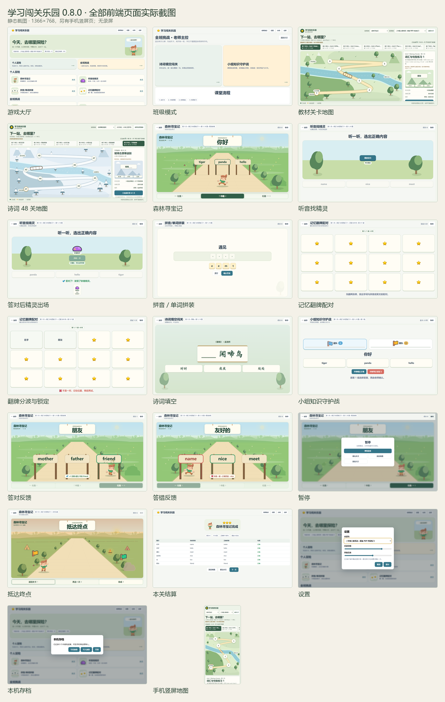
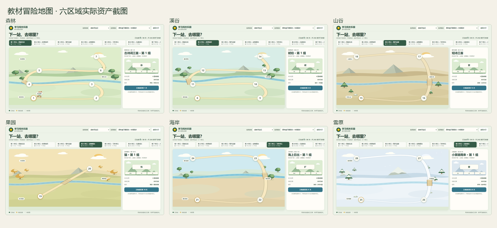
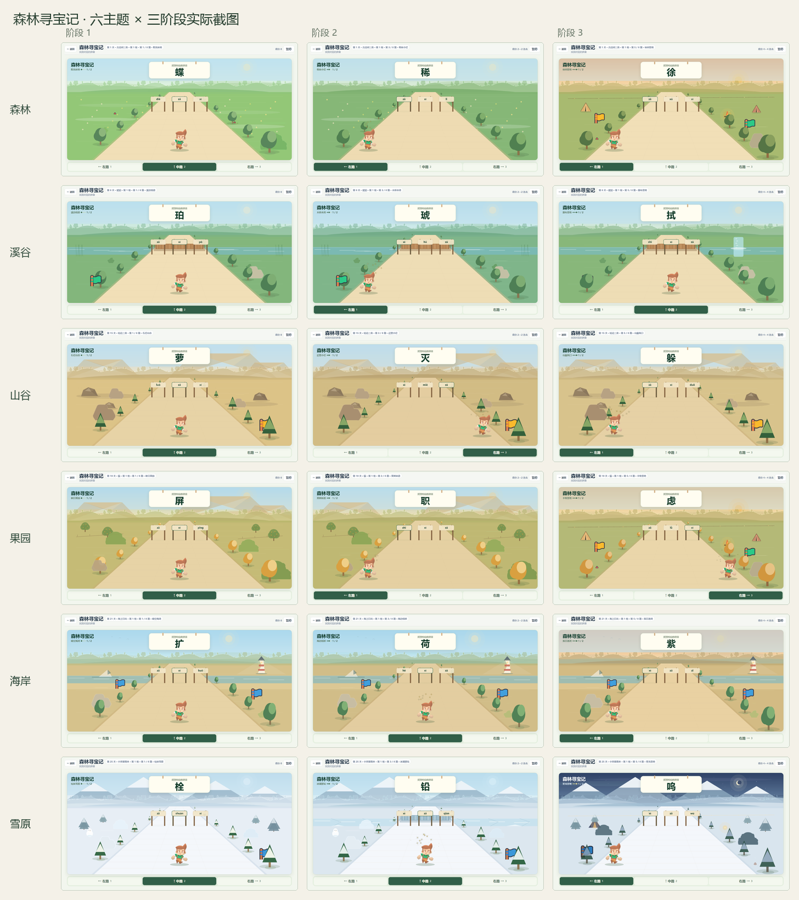

# classGame 0.8.0 教材对应与构建报告

日期：2026-11-23

## 结论

本轮按教材审查建议，优先重做一年级上册语文与三年级上册 PEP 英语的教材对应关系，并把旧包明确降级为“旧版练习/通用拓展”。版本升级为 `0.8.0`。

已核验到的是：统编语文修订版的结构变化、部分课文/儿歌栏目，以及新版 PEP 三上的单元标题和栏目结构。未取得官方可机读逐课字表或英语词表文本的内容，明确标为待核验，不声称全学段新版同步已完成。

## 构建产物

| 项目 | 实际结果 |
|---|---|
| 文件 | `release/classGame-0.8.0-x64-setup.exe` |
| 大小 | 167,338,907 字节（159.57 MiB） |
| 构建时间 | 2026-11-23 12:34:56 |
| SHA-256 | `13EDA2C1AF584CF2F42AD6560A8B11C860380ABDB7514ECFF90CF079CE12DD7F` |
| 数字签名 | 未签名（electron-builder 日志：`no code signing certificate configured, signing is skipped`） |
| 便携版 | 本轮未生成 |

## 教材对应

### 一年级上册语文

新包 ID：`g1-chinese-2024-a`，文件：`data/G1-语文-上册-2024修订版.json`。

- 5 个单元、25 个练习节点、172 道字词/拼音练习，音频均复用已生成且文本一致的 WAV。
- 按人教社修订说明组织 8 课识字与 3 个拼音单元；`i u ü` 与 `y w` 已拆成独立关卡。
- 旧版《日月水火》改为《日月山川》，题目中的“石”调整为“川”；删除旧包中挂在 `b p m f` 下多出的 14 组错位字词。
- 记录拼音儿歌《欢迎台湾小朋友》：它是伴随拼音学习的儿歌，不是独立编号阅读课文。
- 记录新增课文《两件宝》；阅读课文由 14 篇减为 10 篇的结构变化已写入单元说明。
- 状态：`structure_verified_lesson_details_pending`。逐课字表、版权页版次/印次和教师终审仍未完成。

来源：

- https://www.pep.com.cn/rjdt/mtbd/202408/t20240827_1994380.shtml
- https://www.pep.com.cn/xw/zt/hd/sktbjc/bxgs/202606/t20260611_2006816.html

### 三年级上册 PEP 英语

新包 ID：`g3-english-pep-2024-a`，文件：`data/3年级上英语-新版PEP对应练习.json`。

- 7 个官方栏目、14 个练习节点、78 道自编词语/句型练习。
- 六个教学单元标题按人教社三年级上册配套资源页逐一核对：`Making friends`、`Different families`、`Amazing animals`、`Plants around us`、`The colourful world`、`Useful numbers`。
- 复习单元 `Revision: Being a good guest` 已纳入地图。
- 人教社新教材简介确认三年级起点、三上至六上每册 6 个教学单元和 1 个复习单元；六下应为 4 个教学单元和 1 个总复习单元。
- 状态：`unit_titles_and_sections_verified_wordlist_pending`。配套页的 `Words in each unit` 只提供音频，未提供可机读词表文本，练习词项不能标为官方教材词表。

来源：

- https://www.pep.com.cn/zslth/yyptypzj/xypep/3s/
- https://www.pep.com.cn/xw/zt/hd/12/xjcjs/xx/202409/t20240920_1995564.html

## 旧内容处理

- `g1-chinese-a`：`legacy_unverified`，旧版字词练习。
- `g1-chinese-pinyin`：`legacy_unverified`，旧版拼音练习；不再标成 2024 统编版，也不再保留 `reviewed: true` 假审核状态。
- `g3-english-basic`：`legacy_unverified`，旧版开源词表。
- 旧包继续保留原 ID 和进度，不覆盖用户既有存档；新版包使用独立 ID，课序变化不会导致旧进度错位。
- `tools/import_curriculum.py` 不再硬编码 `edition: "2024 统编版"`，也不再把第三方拼音条目标成已审核。

## 数据元数据

两个新版包均含：

- `publisher`、`series`
- `curriculumStandard`
- `textbookEdition`、`textbookActivation`
- `alignmentStatus`、`alignmentSources`
- `verificationDate`、`reviewedBy`、`notes`

地图选择框和关卡详情会显示“新版结构已核验 / 新版主题已核验 / 旧版或拓展”等状态，避免把自研题库包装成教材原文或官方目录。

## 验证

- `conda run --no-capture-output -n GAME python tools/validate_content.py`：通过；28 个内容包、13 册英语、13 册语文、4726 条非诗词学习条目、48 个诗词关卡、384 个诗词变体。
- `conda run --no-capture-output -n GAME npm test`：42 项测试全部通过（41 项浏览器测试 + 冒烟/回合计划测试按项目脚本执行）。
- 新增浏览器断言：默认进入新版 PEP 包；新版语文与英语显示核对状态；新版包排在旧包之前；切换新版包不会在旧版包中写入进度。
- 新增内容断言：两个新版包元数据齐全；旧包必须标记为 `legacy_unverified`；一上拼音拆分、日月山川、拼音儿歌、两件宝记录、三上七个官方标题均通过检查。

## 静态截图

静态汇总：`docs/screenshots/0.8.0-pages-overview.png`，688,038 字节，SHA-256 `EE75C470A825862725B6B6B51EC1E1BDC3535769207C4C3A5A82BBE96820705C`。

本轮只提供静态截图，不提供录屏。

## 已知边界

- 官方逐课词表、教材版权页版次/印次、教师终审和音频听审未完成。
- 没有复制教材正文、整篇课文、PDF 或插图，只保存课次映射和自编练习题。
- 安装包未签名；本轮不把构建成功等同于安装、卸载、断网或希沃真机通过。
- 48 首诗词仍是主题拓展包，不宣称覆盖任意出版社/年级/册次的全部古诗。
